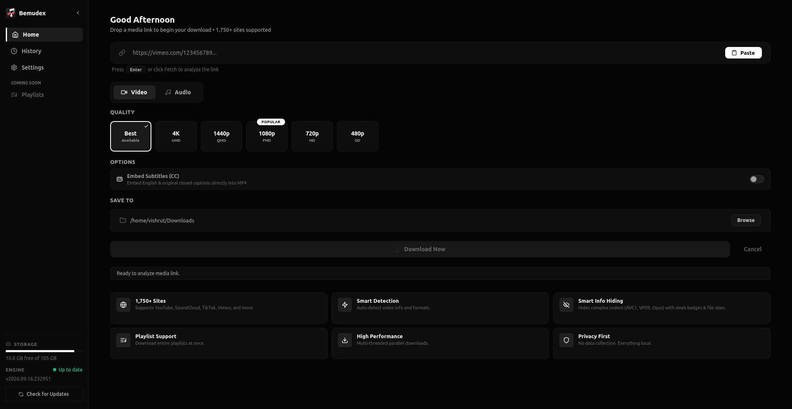
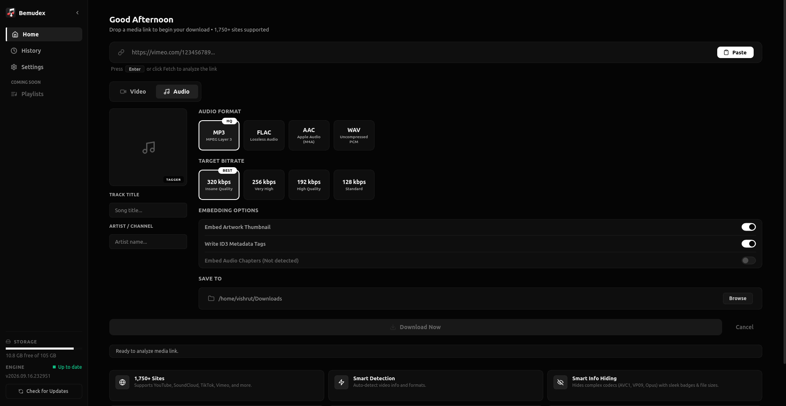
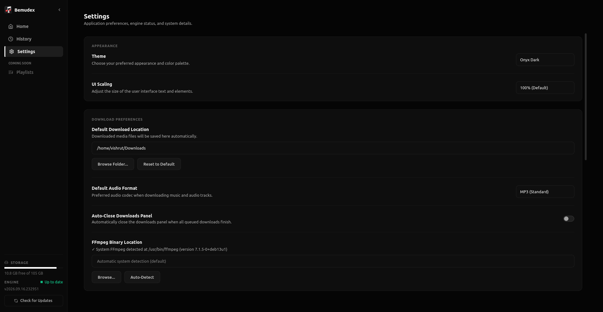
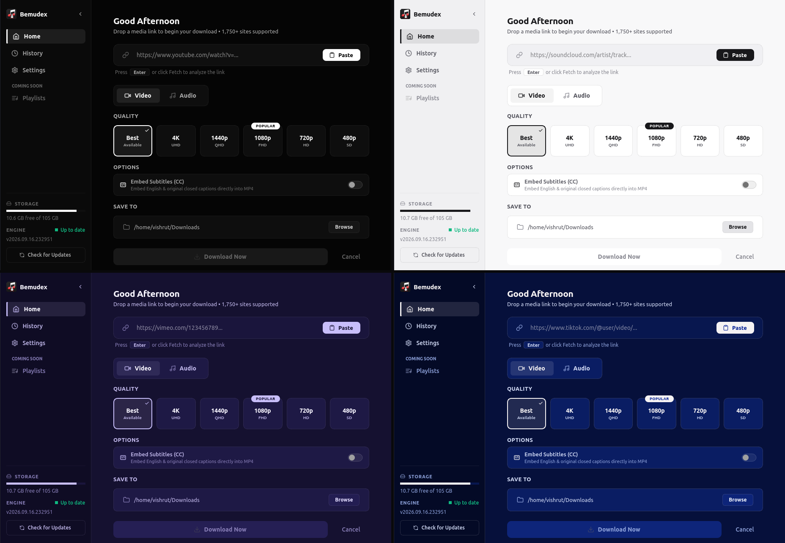

<div align="center">

# 🎧 Bemudex


**A modern desktop media downloader powered by yt-dlp and FFmpeg, featuring audio/video conversions, metadata tagging, and a self-updating engine.**

[⬇️ Download Latest Release](https://github.com/vish-1109/Bemudex/releases)

</div>

---

## 📸 Screenshots

<div align="center">
  
  <p><em>Main download interface with video quality selection</em></p>
  
  <br>
  
  
  <p><em>Audio download mode with format and bitrate selection</em></p>

  <br>
  
  
  <p><em>Settings page showing dependencies status and system diagnostics</em></p>

  <br>

  
  <p><em>Built-in theme options (Onyx Dark, Minimal Light, Lavender Tonic, Imperial Blue, Creole Matcha, and Masterpiece Red)</em></p>
</div>

---

## ✨ Features

| Feature | Description |
|:---|:---|
| **Native Qt Interface** | Developed in native Qt (PyQt6) for seamless Linux desktop integration. |
| **Multi-Format Media** | Download high-definition video as **MP4** or convert audio to **MP3, M4A, FLAC, or WAV**. |
| **Custom Audio Bitrates** | Select preferred audio fidelity: **320 kbps**, **256 kbps**, **192 kbps**, or **128 kbps**. |
| **Subtitle Embedding** | Option to embed English and original closed captions directly into MP4 containers. |
| **Parallel Download Queue** | Download playlist items concurrently using a multi-threaded queue with individual item cancel/retry controls. |
| **One-Click Engine Updater** | Automatically checks for upstream `yt-dlp` updates with one-click atomic updates and rollback protection directly from the sidebar. |
| **Automatic Tagging & Covers** | Embeds artist, title, chapter markers, and high-resolution thumbnail artwork directly into media files. |
| **Smart Clipboard Monitor** | Detects media URLs copied to your clipboard and prompts one-click download analysis. |
| **Theme Engine & UI Scaling** | 6 built-in themes (Onyx Dark, Minimal Light, Creole Matcha, Lavender Tonic, Masterpiece Red, Imperial Blue) with high-DPI scaling (90% to 175%). |
| **Disk Space Diagnostics** | Real-time disk space gauge and download directory validation before starting a job. |

---

## 📦 Download & Install

### 🐧 Linux (Recommended Installers)

#### Debian / Ubuntu / Linux Mint / Pop!_OS (.deb)
Download `bemudex_3.0.0_amd64.deb` from the [Releases](https://github.com/vish-1109/Bemudex/releases) page and install it:
```bash
sudo apt install ./bemudex_3.0.0_amd64.deb
```
*(This automatically resolves and installs all required dependencies including FFmpeg. Alternatively, double-click the `.deb` file in your system software center.)*

#### Universal Linux (.AppImage)
Download `Bemudex-x86_64.AppImage` from the [Releases](https://github.com/vish-1109/Bemudex/releases) page and run:
```bash
chmod +x Bemudex-x86_64.AppImage
./Bemudex-x86_64.AppImage
```

**FFmpeg Requirement for AppImage**

The AppImage runs as a standalone bundle, but relies on your system FFmpeg installation for format conversions, audio extraction, and metadata tagging. If FFmpeg is not already installed on your system, install it using your package manager:

* **Debian / Ubuntu / Mint / Pop!_OS:** `sudo apt install ffmpeg`
* **Fedora / RHEL:** `sudo dnf install ffmpeg`
* **Arch Linux / Manjaro:** `sudo pacman -S ffmpeg`
* **openSUSE:** `sudo zypper install ffmpeg`

---

## 🛠️ Manual Installation (Build from Source)

If you prefer to run the application directly via Python:

### Requirements
* **Python 3.10+**
* **FFmpeg** (Required for media conversions and tagging)

### Build Instructions

**1. Clone the repository**
```bash
git clone https://github.com/vish-1109/Bemudex.git
cd Bemudex
```

**2. Install FFmpeg**
* **Debian / Ubuntu:** `sudo apt install ffmpeg`
* **Fedora:** `sudo dnf install ffmpeg`
* **Arch Linux:** `sudo pacman -S ffmpeg`

**3. Setup Python environment & run**
```bash
python3 -m venv venv
source venv/bin/activate
pip install -r requirements.txt
python main.py
```

---

## 📄 License

This project is licensed under the **GNU General Public License v3 (GPL-3.0)** — see the [LICENSE](LICENSE) file for details.
